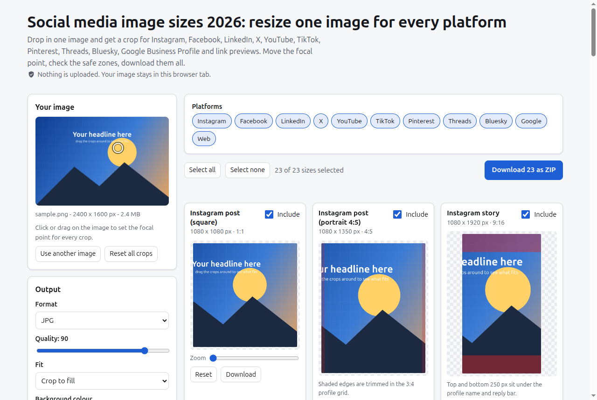

# Social Image Sizer

Resize one image to every social media size and download them all.

**Live: https://mizoz.github.io/social-image-sizer/**



I built this because every time I post an event I end up cropping the same photo eight times for Instagram, LinkedIn, X, a YouTube thumbnail and whatever else, and then finding out the LinkedIn profile photo sits right on top of the text. So now I drop the image in once and get all of them.

## What it does

- Drop, paste (Ctrl+V / Cmd+V) or pick one image
- Instant crops for 23 sizes: Instagram (square, 4:5, story, reel), Facebook (post, cover, event), LinkedIn (post, personal banner, company cover, article cover), X (post, header), YouTube (thumbnail in HD and 4K, channel banner), TikTok, Pinterest, Threads, Bluesky (post, banner), Google Business Profile and Open Graph 1200x630
- Click your image to set one focal point for all crops, or drag/zoom any single crop
- Red overlays where the platform covers your image: story top and bottom, reel caption and buttons, YouTube banner safe area, LinkedIn and X profile photo overlap, and so on
- JPG, PNG or WebP with a quality slider, or "fit" mode that pads with a colour instead of cropping
- Download one, or tick the ones you want and get a ZIP. Files are named like `instagram-post-1080x1080.jpg`
- Remembers your format and picks, and puts them in the URL so you can share a setup
- Keyboard works: arrows move a crop, +/- zooms
- Size reference table and FAQ on the page

## Privacy

Nothing gets uploaded. It's plain canvas in your browser, no server, no analytics, no cookies. The only outside file is JSZip from cdnjs (with an SRI hash) for the ZIP download.

## How it works

Each preset is a width, height and a list of overlay rectangles. The crop is "cover" scaling times your zoom, centred on the focal point and clamped to the image edges. Previews draw from a downscaled copy so dragging stays smooth, and the export redraws from the full original at the exact output size.

## Run it locally

```
git clone https://github.com/mizoz/social-image-sizer.git
cd social-image-sizer
python3 -m http.server
```

Then open http://localhost:8000.

## Sources

Last checked 2026-10-21. Where a platform doesn't publish a number, the page says "recommended" and uses the common size.

- LinkedIn Pages image specs (company cover 1512x256, post image 1200x627): https://www.linkedin.com/help/linkedin/answer/70781
- LinkedIn profile background 1584x396 (4:1, up to 8 MB), per LinkedIn Help "background photo" page, cross-checked with https://linearity.io/blog/linkedin-size-guide/
- YouTube channel banner 2560x1440 recommended, 2048x1152 minimum with a 1235x338 safe area (same area as 1546x423 at full size), 6 MB: https://support.google.com/youtube/answer/10456525?hl=en
- YouTube thumbnails, 3840x2160 recommended, min 640 wide, 2 MB phone / 50 MB desktop: https://support.google.com/youtube/answer/72431?hl=en
- Facebook cover photo display sizes (820x312 desktop, 640x360 phone): https://www.facebook.com/help/125379114252045
- Google Business Profile photos (720x720 recommended, 10 KB to 5 MB): https://support.google.com/business/answer/6103862?hl=en
- Meta Stories safe zone (about 14%, 250 px, top and bottom): https://www.facebook.com/business/help/980593475366490
- Instagram 3:4 profile grid (2025 change) and 4:5 feed: Instagram announcements, cross-checked with https://recurpost.com/blog/instagram-post-size-guide
- TikTok safe area, Pinterest 2:3, Threads 4:5, Bluesky and X sizes: no single official page with pixel numbers, so these are the common recommendations, e.g. https://linearity.io/blog/threads-size-guide/ and https://postiz.com/tools/bluesky-photo-resizer
- Profile photo / logo overlap areas on LinkedIn, X and Bluesky banners are my approximations from the current layouts, not official numbers

Spot something out of date? Open an issue.

## License

MIT, see [LICENSE](LICENSE).
